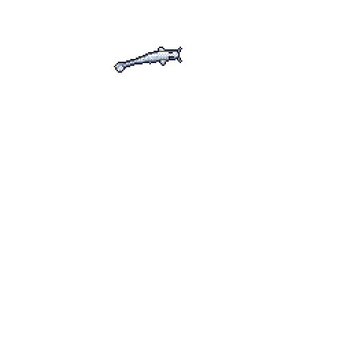

<h1 align="center">Hey, I'm Eric 👋</h1>

  <i>Building things, understanding how they work, and making them better.</i>

  <!-- Place your GitKoi whale image here -->
  

---

### `$ whoami`

Computer science student interested in systems programming, 
high-performance computing, and software engineering.

I enjoy exploring the intersection of software, hardware, 
and performance.

### `$ currently_learning`

- C & C++ — Systems programming and performance
- Rust & Go — Modern systems and backend development
- Linux, compilers & parallel computing
- Computer architecture and digital design

### `$ technologies`

`C` `C++` `Rust` `Go` `Python` `C#` `Linux` `Git` `CMake`

### `$ philosophy`

> Understand the fundamentals. Build things. Break things. Learn.

---

  <i>Still learning. Always building.</i>

